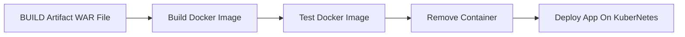

# vProfile – Java Web App with Jenkins CI/CD & Kubernetes

         

> Multi-tier Java web application with a full Jenkins → Docker → Kubernetes pipeline.

## Overview

**vProfile** is a multi-tier Java web application (Spring MVC, Spring Security, Spring Data JPA, JSP) packaged as a WAR and served by **Tomcat**, backed by **MySQL**, **Memcached** and **RabbitMQ**. This repository wraps it in a complete DevOps workflow: build with Maven, containerise with Docker, and deploy to Kubernetes through a Jenkins pipeline.

## Tech Stack

- **Java**
- **Spring**
- **Maven**
- **Tomcat**
- **MySQL**
- **Memcached**
- **RabbitMQ**
- **Docker**
- **Jenkins**
- **Kubernetes**

## Repository Structure

```text
Dockerfile
index.html
Jenkinsfile
kubernetes/app-secret.yml
kubernetes/app-service.yml
kubernetes/db-cip.yml
kubernetes/deployment-app.yml
kubernetes/deployment-db.yml
kubernetes/deployment-mc.yml
kubernetes/deployment-rmq.yml
kubernetes/mc-cip.yml
kubernetes/rmq-cip.yml
new-file
pom.xml
README.md
src/main/java/ …
src/main/resources/ …
src/main/webapp/ …
src/test/java/ …
```

## Getting Started

### Prerequisites

- JDK 11 and Maven 3
- Docker
- A Kubernetes cluster (e.g. Minikube) and `kubectl`

### Build & Run Locally

```bash
mvn clean install -DskipTests
docker build -t vprofile-app .
docker run -d -p 8080:8080 vprofile-app
```

Then open http://localhost:8080.

### Deploy to Kubernetes

```bash
kubectl apply -f kubernetes/
```

## CI/CD Pipeline

The `Jenkinsfile` defines the following stages:



## Author

**Gamal Mohammad**

[](https://github.com/Gamal-Mohammad)
